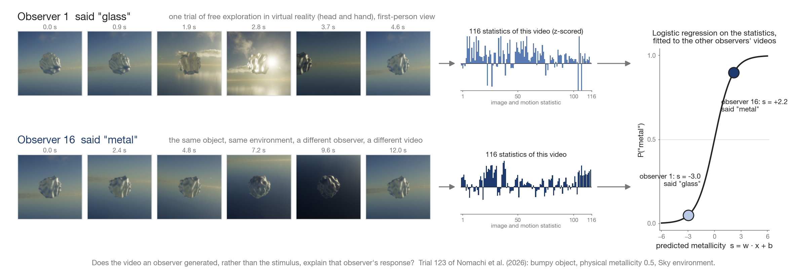

# Active exploration generates observer-specific image evidence for material identity

<p align="center"></p>

Code and data of the manuscript *Active exploration generates observer-specific
image evidence for material identity* (T. Morimoto, R. Nomachi and H. Tamura).
In Experiment 3 of Nomachi, Tamura, Helgeland, Morimoto, Nakauchi and Minami
(2026, *Journal of Vision*, 26(6):4, https://doi.org/10.1167/jov.26.6.4),
19 observers judged whether a rendered object was made of metal or glass while
exploring it freely in virtual reality: by turning it in the hand, by moving the
head, or both (120 trials each), and in a fourth condition without exploration
(40 trials). Every first-person video an observer generated was recorded. This
repository describes each video by 116 simple statistics (object, object versus
surround, and optic-flow statistics), fits logistic regressions from the
statistics to the observers' responses, and asks whether the video an observer
generated, rather than the stimulus, explains that observer's response.

The Python scripts in [`python/`](python/) extract the statistics from the
frames and fit and test the models; the MATLAB scripts in the repository root
draw the figures from the resulting tables. The per-trial statistics and every
model output are shipped in [`results/`](results/), so the figures and all the
numbers quoted in the paper can be regenerated without the 200 GB of frames.

## 1. Requirements

* Python 3.11 with numpy, pandas, scipy, scikit-learn and Pillow; OpenCV
  (`opencv-python`) only for the optic-flow statistics
  ([`python/requirements.txt`](python/requirements.txt); tested with numpy
  2.2, pandas 3.0, scikit-learn 1.8, scipy 1.17, OpenCV 5.0 on macOS).
* MATLAB R2020a or newer (tested on R2025b) with the Statistics and Machine
  Learning Toolbox (`boxplot`, `quantile`) for the figures. Every helper is in
  [`utils/`](utils/); nothing else has to be downloaded.

## 2. Installation

```
git clone https://github.com/takuma929/material_exploration_modelling.git
cd material_exploration_modelling
pip install -r python/requirements.txt
```

No build step. The MATLAB scripts resolve their paths relative to their own
location and add `utils/` to the path; the Python scripts resolve them from
`python/common.py`. Run the Python scripts from `python/`.

## 3. Regenerate the figures

In MATLAB, make the repository the current folder and run

```matlab
run_all
```

This runs the eight figure scripts in turn and writes `figs/fig1` to `fig7`
and `figA1` as PDF and PNG; each script also prints the values it plots
(medians, means, AUCs) to the Command Window. A single figure is regenerated by
running its script, e.g. `fig7_disagreement`. The figures are built at the
width they are printed at (17.8 cm or 8.9 cm; [`utils/figstyle.m`](utils/figstyle.m)).

## 4. Recompute the models and the numbers

The tables in `results/` were produced by the scripts in `python/`. To recompute
every model output and every number of the paper from the shipped per-trial
statistics (the permutation and swapped-video tests take most of the time):

```
cd python
sh run_pipeline.sh models
```

`run_pipeline.sh` runs the scripts in the order below and ends with
`numbers_for_text.py`, which writes [`results/numbers.json`](results/numbers.json):
every number quoted in the paper, keyed by the placeholder it fills (e.g.
`stats_auc_lopo`, the leave-one-observer-out AUC of the main model). Running
`sh run_pipeline.sh` without an argument also runs the extraction stage, which
needs the frames (section 6).

## 5. Scripts

### 5.1 Figures (MATLAB, repository root)

| Script | Figure | Content |
| --- | --- | --- |
| `fig1_stimuli.m` | 1 | What the observers saw and what the models were given: the first-person view in each environment with the model's patch outlined; the patches along physical metallicity for the two shapes; the patches of every environment |
| `fig2_model.m` | 2 | How the own-video model is built and tested, on real data: one video becomes 116 statistics; the responses of all observers; the fitted logistic regression scores the left-out observer's videos; the 19 videos of one trial scored by the model of the disagreement test |
| `fig3_behaviour.m` | 3 | The observers' responses: proportion of "metal" against physical metallicity by environment, shape and condition; viewing duration by condition |
| `fig4_predictors.m` | 4 | AUC for each observer's responses of the statistics of the own video, of the same statistics reduced to 20 principal components and of physical metallicity, against the ceiling set by the other observers; the same by condition, including the condition without exploration |
| `fig5_statistics.m` | 5 | The 16 single statistics that predict the responses best: the eight whose higher values go with "metal" and the eight whose lower values do |
| `fig6_statistics_observers.m` | 6 | The AUC of every statistic for every observer, by family, with the best statistic in each direction named |
| `fig7_disagreement.m` | 7 | The disagreement test: two observers who saw the same trial and answered differently; the AUC over all disagreeing pairs, by environment and by shape, by the distance between the two videos, and by the part of the trial the statistics were computed from, each against its permutation null |
| `figA1_statistics.m` | A1 | How each statistic is computed, illustrated on one frame, one frame pair and the time series of one trial |

### 5.2 Models and analyses (Python, `python/`)

Scripts that read only the shipped tables (`data/trials.csv`,
`data/static_trials.csv`, `results/features/`), in the order of `run_pipeline.sh`:

| Script | Content | Writes |
| --- | --- | --- |
| `common.py` | Paths, the trial-folder naming, the object-plus-surround crop, the name of the main feature set (`MAIN_FEATURES`) | |
| `behaviour_analysis.py` | Responses and viewing durations of the three exploration conditions; per-observer AUCs of the two reference predictors | `results/behaviour/trial_means.csv`, `observer_summary.csv`, `condition_means.csv` |
| `evaluate.py <feature_set>` | One model: L2 logistic regression (C = 0.1) on the statistics z-scored within observer. Leave-one-observer-out AUC, overall and by condition; the disagreement test with its permutation null (300 shuffles), scored leave-one-stimulus-out; the swapped-video control; the reference predictors | `results/models/<feature_set>_C0.1.csv` (one row of summary values), `_scores.csv` (per video), `_observer_auc.csv` (per observer) |
| `regularization_grid.py` | The main model over a grid of C | `results/models/regularization_grid.csv` |
| `pca_sweep.py` | Leave-one-observer-out AUC with the statistics reduced to k principal components (Figure 4a) | `results/models/pca_sweep.csv`, `pca_sweep_by_observer.csv` |
| `static_block.py` | The condition without exploration: the 23 per-frame quantities of the single image, the same evaluations, transfer to and from the exploration conditions, behaviour of all four conditions (Figures 3 and 4b) | `results/features/static/` (needs `data/static`; shipped), `results/models/static_block*.csv`, `results/behaviour/static_*.csv`, `block_means.csv` |
| `within_trial_breakdown.py` | The disagreement test over all pairs, by environment and by shape, with the null of each and per observer (Figure 7b, d) | `results/models/within_trial_breakdown*.csv`, `within_trial_null_all.csv` |
| `within_trial_by_similarity.py` | The disagreement test by the distance between the two videos in the space of the statistics (Figure 7c) | `results/models/within_trial_by_similarity*.csv`, `within_trial_pairs.csv` |
| `within_trial_by_difference.py` | The same by the difference in predicted metallicity and by physical metallicity, with a swapped-video control | `results/models/within_trial_by_difference*.csv`, `within_trial_by_level.csv` |
| `within_trial_features.py` | Is it just viewing duration? The main model with duration partialled out and duration alone; single statistics and subsets of the statistics in the disagreement test | `results/models/duration_control*.csv`, `within_trial_features.csv`, `feature_ablations.csv` |
| `single_statistics.py` | The AUC of every statistic alone for each observer's responses, group and per observer, with a permutation null (Figures 5 and 6) | `results/models/single_statistics.csv`, `single_statistics_by_observer.csv` |
| `observer_within_trial.py` | The disagreement test per observer for every model, and the paired tests between models across observers | `results/models/within_trial_by_observer.csv`, `within_trial_tests.csv` |
| `collect_results.py` | The two tables the figures read | `results/summary/per_observer_auc.csv`, `model_summary.csv` |
| `save_model_illustration.py` | The statistics and weights of the example video of Figure 2 | `data/example_frames/model_illustration.csv` |
| `numbers_for_text.py` | Every number quoted in the paper | `results/numbers.json` |

Scripts that read the frames (`data/imgs`, `data/static`; not distributed):

| Script | Content | Writes |
| --- | --- | --- |
| `build_trial_table.py` | One row per observer and trial from the frame folders | `data/trials.csv` |
| `import_static_block.py` | The single frame of each trial without exploration, from the raw export | `data/static/`, `data/static_trials.csv` |
| `extract_image_stats.py --crop object [--window ...]` | The 15 object quantities per frame (object crop), summarized over the trial: the 63 object statistics | `results/features/image_stats_object[_<window>]/` |
| `extract_relational_stats.py` | The 9 relational quantities per frame (the object against its surround on the patch), summarized over every window: the 37 relational statistics | `results/features/relational_frames/`, `relational[_<window>]/` |
| `extract_flow_cues.py` | The optic-flow quantities of Doerschner et al. (2011) per frame pair, summarized over every window: the motion statistics | `results/features/flow_frames/`, `flow[_<window>]/` |
| `save_example_frames.py <what> ...` | The example frames of the figures | `data/example_frames/` |
| `preprocessing/crop_transparent_objects.m` (MATLAB) | The object-only crops (`Cropped`) from the frames with the object alone (`Transparent`) | `data/imgs/participant_XXX/Cropped/` |

`assets/make_thumbnail.py` draws the image at the top of this page from the
frames and the model outputs.

## 6. Data

### 6.1 The trials (`data/trials.csv`, `data/static_trials.csv`)

One row per observer and trial. `participant` is the observer (`001` to `020`
without `009`; 19 observers), `trial` the trial ID, `env` the illumination
environment (Check, Gray, Sky, Studio), `geom` the shape (Bumpy, Smooth),
`metal` the physical metallicity (the metallic parameter of the rendering, 0,
0.25, 0.5, 0.75 or 1), `resp` the response (1 = "metal", 0 = "glass"),
`modality` the condition (`hand`: trial IDs 41 to 80, hand only; `head`: 81 to
120, head only; `both`: 121 to 160, head and hand; `static`: 1 to 40, no
exploration), `n_frames` the number of frames recorded and `t_first_ms`,
`t_last_ms` the time stamps of the first and last frame (the viewing duration is
their difference; `dur_s` in `static_trials.csv`). `folder` is the name of the
trial's frame folder, `<trial ID>_<env>_<geom>_<metal>_<resp>`. The behavioural
data of the experiment are also at https://osf.io/xzunv/ (Nomachi et al., 2026).

### 6.2 The frames (`data/imgs/`, `data/static/`; not distributed)

The first-person recordings (200 GB) are available from the authors on request.
Their layout, which the extraction scripts expect, is

```
data/imgs/participant_XXX/Color/<folder>/<time_ms>.png         720 x 720 RGB screenshot of the observer's view
data/imgs/participant_XXX/Transparent/<folder>/<time_ms>.png   the object alone on a transparent background (RGBA)
data/imgs/participant_XXX/Cropped/<folder>/<time_ms>.png       224 x 224 object-only crop (preprocessing/crop_transparent_objects.m)
data/static/participant_XXX/{Color,Transparent,Cropped}/<folder>/<time_ms>.png   the one frame kept of each trial without exploration
```

Screenshots were taken every fifth rendered frame (about 17 ms apart); the
time stamps in ms are the file names. The patch given to the models is a square
window centred on the object with a margin of a quarter of the object's size on
each side, resized to 224 x 224 (`common.context_crop`): glass transmits and
metal reflects the surroundings, so an object cut from its background carries no
reference against which the two can be told apart.

### 6.3 Example frames (`data/example_frames/`)

The frames and patches the figures show, written by `save_example_frames.py`:
`view_<env>_<geom>_m<0|1>.png` and `ctx_*.png` (a view and its patch for every
environment and shape, with `boxes.csv` giving the crop box), `levels_Sky_*.png`
(along physical metallicity), `timecourse*` (one trial over time, with its
per-frame statistics in `timecourse_stats.csv`), `pair_<metal|glass>_*.png`
and `pair.csv` (the two observers of Figure 7a), `score_*`, `trial_*` and their
CSV files (the example videos of Figure 2), `example_object.png`,
`example_patch[_mask].png`, `consecutive_*.png`, `flow_example_*` (Figure A1)
and `model_illustration.csv` (Figure 2).

### 6.4 The statistics (`results/features/`)

One folder per feature set, one CSV per observer (`participant_XXX.csv`, one
row per trial with `participant`, `trial`, the number of frames used and one
column per statistic). The 116 statistics of the main model are the union of
three families, each computed per frame and summarized over the trial by its
mean, standard deviation, maximum and the mean over the second half of the
frames minus the mean over the first half (`<quantity>_mean`, `_sd`, `_max`,
`_late_minus_early`), plus the lag-one autocorrelation of four of them
(`_ac1`). Table A1 of the paper defines every quantity.

| Folder | Family | Per-frame quantities | Statistics |
| --- | --- | --- | --- |
| `image_stats_object/` | object | 15, over the object's own pixels: `area`, `Y_mean`, `Y_sd`, `Y_med`, `Y_max`, `Y_skew`, `Y_kurt`, `rms_contrast`, `hl_frac`, `hl_contrast`, `edge_energy`, `dark_frac`, `chroma_mean`, `chroma_sd`, `diff_energy` | 63 |
| `relational/` | relational | 9, the surround and the object against it: `bg_Y_mean`, `bg_Y_sd`, `bg_Y_max`, `bg_rms_contrast`, `bg_chroma_mean`, `obj_bg_lum_ratio`, `obj_bg_contrast_ratio`, `obj_bg_max_ratio`, `obj_bg_chroma_ratio` | 37 |
| `flow/` | motion | 6, from the optic flow between frames two captures apart: `coverage`, `coverage_change`, `div_mean_abs`, `flow_speed`, and `div_frac`, `sfm_inlier_ratio` (undefined in 1 to 2% of the videos and therefore dropped by the models) | 16 used of 24 |
| `*_first2s/`, `*_early_half/`, `*_late_half/` | the same | the same statistics from the first 2 s, the first half or the second half of the video | |
| `static/` | | the 23 per-frame quantities of the single image of each trial without exploration | 23 |

Up to 150 frames per trial, evenly spaced, enter the summaries; the motion
quantities are computed on every pair of consecutive frames. A feature set is
named by its families: `object_relational_flow` is the main model (116),
`object_relational` the 100 image statistics without motion, and
`image_stats_object`, `relational`, `flow` one family alone, each with an
optional window suffix (`evaluate.load_features`).

### 6.5 Model outputs (`results/models/`, `results/summary/`, `results/behaviour/`)

For every evaluated feature set, `evaluate.py` writes `<feature_set>_C0.1.csv`
(one row: leave-one-observer-out AUC overall, by condition, with the other
observers' responses added and with another observer's video; the disagreement
test, its null and its z; the reference predictors), `<feature_set>_C0.1_scores.csv`
(per video: `score`, the leave-one-observer-out predicted metallicity;
`score_plus`, with the other observers' responses as an extra predictor;
`score_swapped`, of another observer's video of the same trial; `score_wt` and
`score_wt_swapped`, the leave-one-stimulus-out scores used by the disagreement
test) and `<feature_set>_C0.1_observer_auc.csv` (per observer). The other files
are named after the script that writes them (section 5.2).
`results/summary/model_summary.csv` collects the one-row summaries of every
feature set and `per_observer_auc.csv` the AUC of every predictor for every
observer; `results/behaviour/` holds the behavioural summaries and the tests of
the condition without exploration. `results/numbers.json` holds every number
quoted in the paper.

## 7. Citation

If you use this code or data, please cite the paper (details will be added on
publication), Nomachi et al. (2026) for the experiment, and this repository.

## 8. License

Released under the [MIT License](LICENSE).
